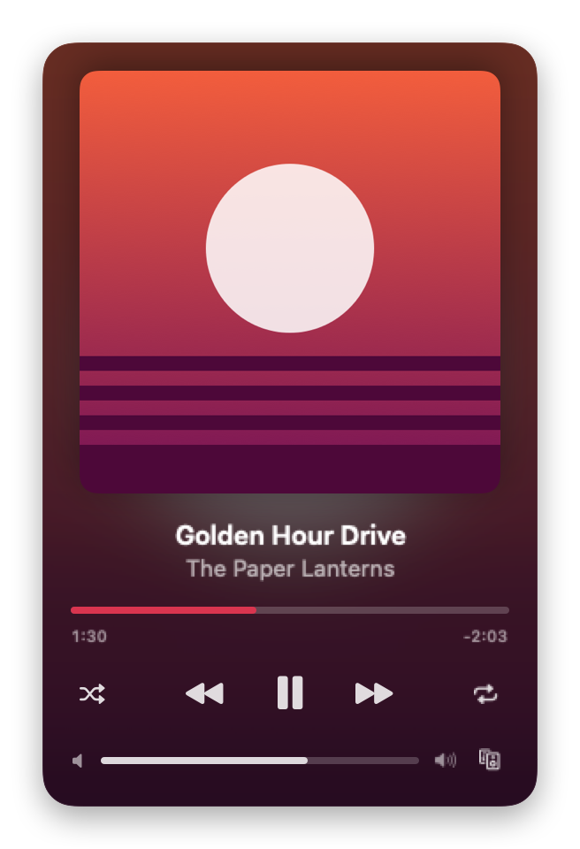
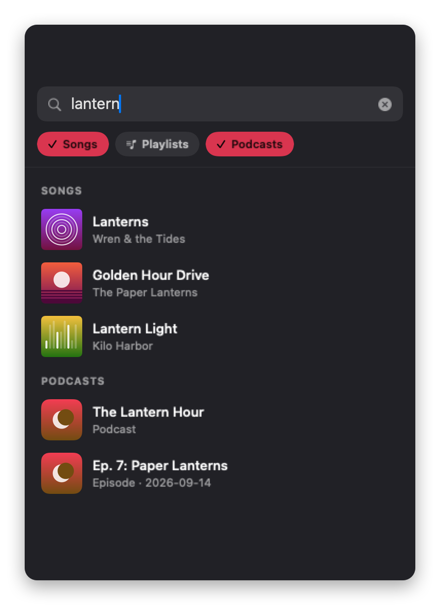
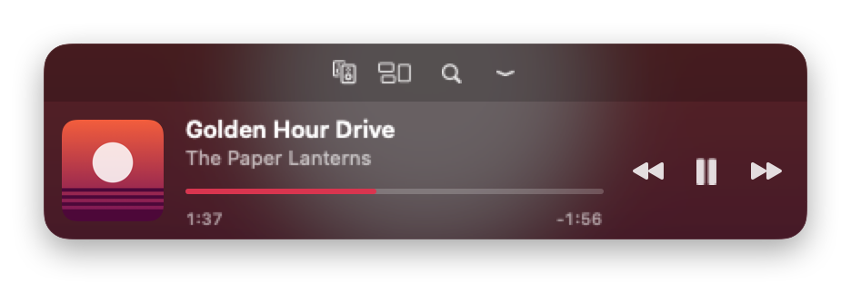
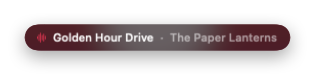
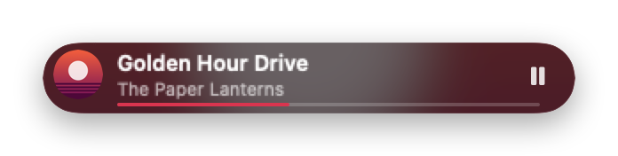
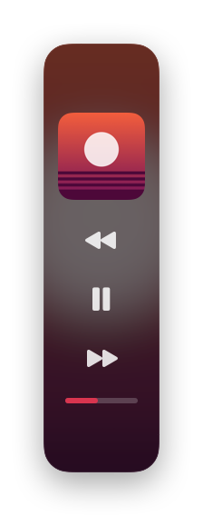
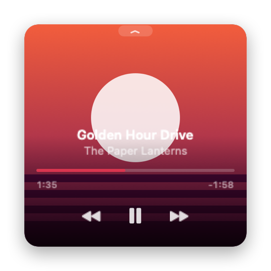
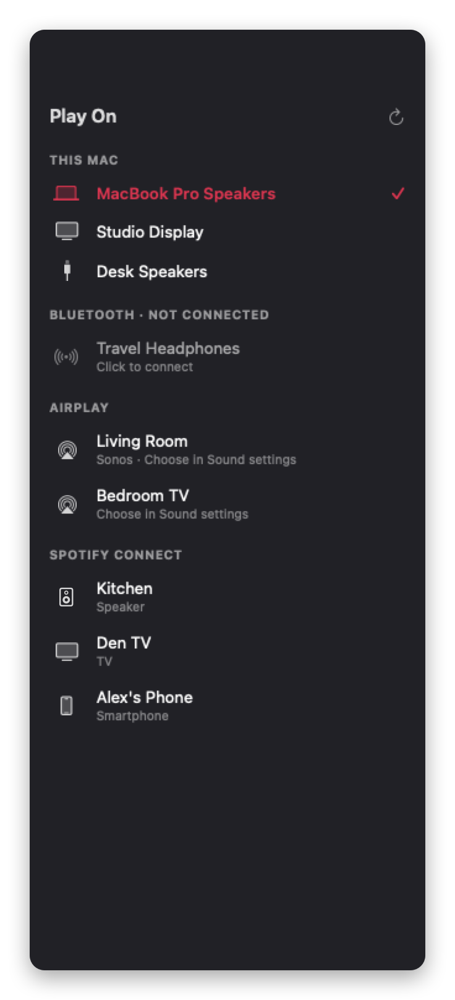
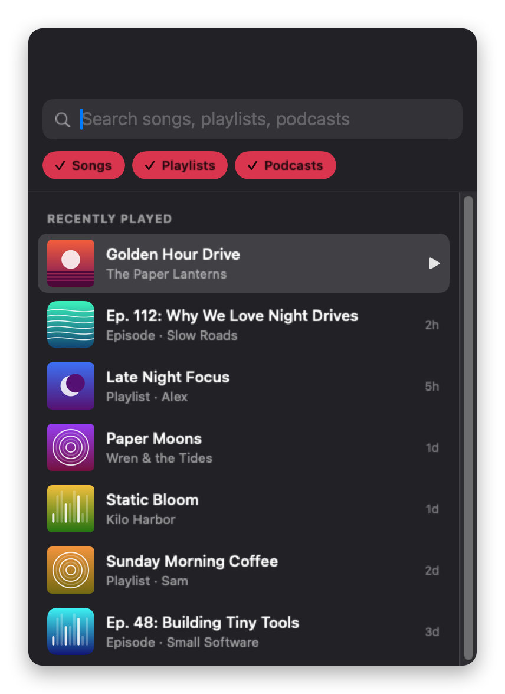

# Dotify

A tiny floating macOS player for Spotify with six layouts, from a one-line ticker to a full card.
It lives in the menu bar (no Dock icon) and drives the Spotify desktop app over AppleScript,
so Spotify itself can stay hidden in the background.

<p align="center">
  
  
</p>

<p align="center">
  
</p>

| Ticker | Pill | Column |
|:---:|:---:|:---:|
|  |  |  |

| Album Art (hover) | Speaker picker | Recently Played |
|:---:|:---:|:---:|
|  |  |  |

<sub>Screenshots use made-up demo content.</sub>

## Requirements

| | Player & playback | Search, history & Spotify Connect speakers |
|---|:---:|:---:|
| macOS 14 Sonoma or later, Apple silicon or Intel | ✓ | ✓ |
| [Spotify desktop app](https://www.spotify.com/download/mac/), installed and signed in | ✓ | ✓ |
| Spotify account | Free or Premium | **Premium** (on the developer app's owner account) |
| Free [Spotify developer app](https://developer.spotify.com/dashboard) and its Client ID | — | ✓ |
| Internet connection | ✓ (Spotify streams) | ✓ |

Dotify only drives the **desktop** app; the Spotify web player won't work. It has no other runtime dependencies:
everything else is built into macOS.

macOS asks for these permissions the first time each feature is used:

| Permission | When | Needed for |
|---|---|---|
| Automation → Spotify | First launch | Reading what's playing and controlling playback (required) |
| Bluetooth | First time the speaker picker opens | Listing and connecting paired speakers |
| Local Network | First time the speaker picker opens | Finding AirPlay and Sonos speakers |
| Keychain | After connecting Spotify | Staying signed in |

## Install

1. Download **Dotify-x.y.z.zip** from the [latest release](https://github.com/bRaInT00T/Dotify/releases/latest)
   and unzip it.
2. Move **Dotify.app** to **Applications**.
3. Open it. Dotify isn't notarized by Apple (that needs a paid Apple Developer ID), so the first launch is blocked
   with "Dotify Not Opened". Click **Done**, then open **System Settings → Privacy & Security**, scroll to
   *"Dotify" was blocked…* and click **Open Anyway**. You only do this once.

   Or, in Terminal:
   ```sh
   xattr -dr com.apple.quarantine /Applications/Dotify.app
   ```
4. Click **Allow** when macOS asks to let Dotify control Spotify. Look for the ♪ icon in the menu bar.
5. Optional: connect Spotify for search, history and speaker switching (see **Connecting** below).

To check the download, compare its SHA-256 with the `.sha256` file on the release page:
```sh
shasum -a 256 ~/Downloads/Dotify-*.zip
```

## Documentation

**Read the docs: <https://braint00t.github.io/Dotify/documentation/dotify/>**

Full guides and code reference are in the DocC catalog at `Sources/Dotify/Dotify.docc`, published to `docs/`
(GitHub Pages serves `main` → `/docs`):

- Getting Started: build, permissions, Spotify in the background
- Layouts and Controls: layouts, toolbar, idle dimming, shortcuts
- Search and Recently Played: search, filters, history sources
- Connecting Spotify: developer app setup, scopes, Spotify's limits
- Choosing Speakers: Mac outputs, Bluetooth, AirPlay, Spotify Connect, Sonos
- Architecture: how the pieces fit, persistence, testing

Regenerate the screenshots (made-up demo content) and the site after changing code or articles:

```sh
./make-screenshots.sh
./generate-docs.sh
```

To browse it locally, serve the parent of a `Dotify` folder that points at `docs/`, then open
`http://localhost:8000/Dotify/documentation/dotify`.

## Build from source

Needs Xcode 16 or later (or a Swift 5.10+ toolchain). The first build needs internet access: Swift Package Manager
fetches [swift-docc-plugin](https://github.com/swiftlang/swift-docc-plugin), which is only used to generate the
docs and isn't part of the app.

```sh
./build-app.sh             # builds build/Dotify.app for this Mac
./build-app.sh --install   # also copies it to /Applications
./build-app.sh --universal # Apple silicon + Intel
swift test                 # run the tests
open build/Dotify.app
```

Locally built copies are ad-hoc signed, so macOS may ask for Automation and Keychain access again after each
rebuild.

### Making a release

```sh
./make-release.sh   # universal build → build/Dotify-<version>.zip + .sha256
```

Bump `CFBundleShortVersionString` in `Resources/Info.plist`, run the script, then attach both files to a GitHub
release tagged `v<version>`.

For a **signed and notarized** release (opens without the "Open Anyway" step), you need a paid Apple Developer
Program membership with a **Developer ID Application** certificate in your login keychain, and a notarization
profile saved once with `xcrun notarytool store-credentials`. Then:

```sh
SIGN_IDENTITY="Developer ID Application: Your Name (TEAMID)" NOTARY_PROFILE=dotify-notary ./make-release.sh
```

The script signs with the hardened runtime and `Resources/Dotify.entitlements` (which allows controlling
Spotify), submits to Apple, staples the ticket, and checks that Gatekeeper accepts it.

## Layouts

| Key | Layout    | Size     | For                                              |
|-----|-----------|----------|--------------------------------------------------|
| 1   | Ticker    | 260×26   | One line of text; controls appear on hover       |
| 2   | Pill      | 300×40   | Thumbnail + title; prev/next appear on hover     |
| 3   | Bar       | 420×76   | Art, title, scrubbable progress, transport       |
| 4   | Card      | 280×432  | Full player: shuffle, repeat, times, volume      |
| 5   | Album Art | 220×220  | Just the cover; everything else on hover         |
| 6   | Column    | 64×236   | Vertical strip to park against a screen edge     |

The panel keeps its top-left corner fixed when you switch layouts, and remembers where you left it.

## Quick-access toolbar & idle dimming

Hover the player and a small tab appears on its bottom edge. Click it (or press **E**) and the player grows
slightly to show a toolbar: **speaker picker**, **layout menu**, **search**, and a collapse arrow. The toolbar
closes on its own once the pointer has left the player and it no longer has focus.

When the pointer is elsewhere and the player isn't focused, it fades to the **Dim When Idle** level
(default 50%; change or turn off in the menu). It returns to full opacity on hover or focus.

## Controls

Click the panel first so it has keyboard focus. It won't pull focus away from other apps.

- **Space** play/pause · **← / →** previous/next · **↑ / ↓** volume
- **1–6** switch layout · **E** show/hide toolbar · **D** speakers · **F** search · **S** shuffle · **R** repeat · **T** always-on-top · **A** album-art background
- **Esc** hide the panel (bring it back from the menu bar ♪ icon)
- Drag anywhere that isn't a control to move it. Right-click for the full menu.

Menu bar / right-click menu: layout, opacity, always on top, show on all Spaces, album-art background,
always show controls, start Spotify in the background, show/hide Spotify.

## Search & Recently Played

Press **F** (or **/**) in the player, or pick **Search & Recently Played…** from the menu.

- Type to search Spotify. Results are grouped into Songs, Playlists and Podcasts (shows and episodes).
- Filter chips are multi-select and apply to both search and recents. Option-click a chip to show only that kind.
- **↑ / ↓** move, **Return** plays and closes, clicking a row plays and keeps the window open, **Esc** clears or closes.
- Picking a podcast show plays its newest episode.

Recently Played merges Spotify's history (last 50 songs, plus the playlists they came from) with a local
history of everything Dotify saw play. Spotify's history API doesn't include podcasts, so podcast
recents only cover what played while Dotify was running. Local history works without connecting.

### Connecting (needed for search and Spotify's history)

Spotify's Web API requires your own developer app:

1. Create an app at <https://developer.spotify.com/dashboard>, ticking **Web API**.
2. Add the redirect URI `http://127.0.0.1:43821/callback`.
3. Paste the app's Client ID into Dotify and click **Connect**, then approve in the browser.

Spotify requires the developer app's owner to have Premium (Development Mode rules since Feb 2026),
and search returns at most 10 results per type. The sign-in token is stored in your login Keychain;
macOS may ask to allow access after a rebuild because the app is ad-hoc signed.

## Choosing a speaker

Press **D** in the player, use the speaker button in the Card layout, or pick **Choose Speaker…** from the menu.

- **This Mac**: built-in speakers, connected Bluetooth devices, USB and display audio. Picking one makes it the
  Mac's default output (Spotify follows it) and pulls playback back to this Mac if it was on another device.
  Virtual drivers (BlackHole, Teams, etc.) sit behind **More**.
- **Bluetooth · Not Connected**: paired speakers and headphones that are off or disconnected. Click to connect
  and switch to them.
- **Spotify Connect**: network speakers, TVs, phones and other devices running Spotify. Click to move playback
  there; the active device gets a volume slider. Needs the Spotify connection with speaker permissions
  (Dotify asks you to reconnect once if your sign-in predates this feature) and Spotify Premium.

- **AirPlay**: AirPlay receivers on your network (Sonos speakers are labelled). macOS doesn't let apps pick an
  AirPlay target, so clicking one opens Sound settings, where it's one click under Output. Once chosen it shows
  under This Mac. This is the way to reach Sonos speakers, which Spotify's API usually doesn't list.

## Notes

- Requires the Spotify desktop app (not the web player). By default Dotify starts Spotify hidden when it
  launches and quits Spotify when it quits; turn either off in the menu ("Start Spotify Hidden on Launch",
  "Quit Spotify When Dotify Quits").
- Liking tracks and viewing the play queue aren't supported yet.
- `make-screenshots.sh` renders every feature with demo content into the DocC catalog (see the Architecture guide).

## License

MIT © 2026 Nicholas Wolk. See [LICENSE](LICENSE).

Dotify is not affiliated with or endorsed by Spotify. Spotify is a trademark of Spotify AB.
